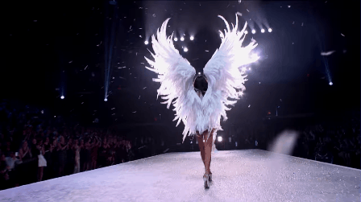

# Victoria Secret Display



A Victoria's Secret runway clip with music playing on an ESP32 "Cheap Yellow Display" (CYD). A heart made of 10 LEDs on a breadboard pulses to the beat of the song, and the display's built-in RGB light glows pink and purple along with it.

The video, music and beat data are all stored on the board, so there is no SD card, Wi-Fi or laptop needed once it's uploaded.

| What happens | On the display | On the LED heart |
| --- | --- | --- |
| Power on | Clip starts | Blinks twice |
| Clip playing | Video + music | Glows softly, flares on the beat |
| Clip ends | Pauses | Two slow "lub-dub" heartbeats, then replays |
| Tap the screen | Clip restarts | Follows the song again |

## Equipment

- ESP32-2432S028R "Cheap Yellow Display" (2.8" ILI9341 touchscreen)
- 10 LEDs (pink, red or white)
- 10 × 220 Ω resistors (one per LED)
- 1 × 330 Ω resistor
- 1 × PN2222 NPN transistor
- Breadboard and jumper wires
- The 4-pin cable that comes with the CYD (for the **P1** connector)
- Optional: a small speaker on the **SPEAK** connector

## Quick start

1. **Install the ESP32 boards in the Arduino IDE.** Go to *Settings*, add `https://espressif.github.io/arduino-esp32/package_esp32_index.json` to *Additional boards manager URLs*, then install **esp32 by Espressif Systems** in the Boards Manager.
2. **Install the libraries.** In the Library Manager, install **GFX Library for Arduino** (by moononournation) and **JPEGDEC** (by Larry Bank).
3. **Wire it up** using the table below.
4. **Put the files together.** `VS.ino` and `kylie_jenner_data.h` need to be in the same folder, named `VS`.
5. **Upload.** Open `VS/VS.ino`, select **ESP32 Dev Module** and your USB port, set *Tools > Partition Scheme* to **Huge APP (3MB No OTA)**, and click Upload.
6. **Watch.** The heart blinks twice, then the clip starts playing.

## Wiring

| From | To |
| --- | --- |
| P1 **VIN** | Both + rails (5V for the LEDs) |
| P1 **TX** | 330 Ω resistor → PN2222 middle leg (base) |
| P1 **GND** | PN2222 left leg (emitter) |
| PN2222 right leg (collector) | LED return (both − rails) |
| Each LED long leg | + rail |
| Each LED short leg | 220 Ω resistor → LED return |
| P1 **RX** | Not used |
| **SPEAK** | Speaker (optional) |

```
                 CYD  P1 connector
            ┌─────┬──────┬──────┬─────┐
            │ VIN │  TX  │  RX  │ GND │
            └──┬──┴──┬───┴──────┴──┬──┘
               │     │   (unused)  │
               │   [330Ω]          │
               │     │             │
               │     │    PN2222   │
               │     │   ┌───────┐ │
               │     └──►│ B     │ │
               │         │     E ├─┘
               │     ┌───┤ C     │
               │     │   └───────┘
               │     │
   + rail ─────┴─────┼──────────────────────────
     │     │     │   │        │
    LED   LED   LED  │  ...  LED     (10 LEDs, long leg to + rail)
     │     │     │   │        │
   [220Ω][220Ω][220Ω]│      [220Ω]
     │     │     │   │        │
   LED return rail ──┴────────┴─────────────────
```

## the build process

Here's the process of how to build this on your own.

### step 1: plan the pins

the CYD already uses most of its pins for the screen, touch and SD card, so there aren't many left over. the **P1** connector gives you **VIN**, **TX** (GPIO 1), **RX** and **GND** on one cable, which is everything the LED heart needs. the speaker uses GPIO 26 (the board's DAC), and the onboard RGB light is on GPIO 4, 16 and 17.

| Function | GPIO |
| --- | --- |
| LED heart (P1 TX) | 1 |
| Speaker (DAC) | 26 |
| Touch | 36 |
| Onboard RGB (R / G / B) | 4 / 16 / 17 |
| Display DC / CS / SCK / MOSI / MISO / backlight | 2 / 15 / 14 / 13 / 12 / 21 |

### step 2: power rails

a jumper from P1 **VIN** goes to both + rails on the breadboard. this is the USB 5V, which is enough to light all 10 LEDs at once.

### step 3: add the transistor

10 LEDs pull more current than an ESP32 pin can safely give, so the TX pin doesn't power them directly. instead it goes through a 330 Ω resistor into the base of a PN2222 transistor. the emitter goes to P1 **GND**, and the collector goes to the − rails, which become the "LED return". when TX turns on, the transistor connects the LEDs to ground and they light up.

### step 4: build the heart

place the 10 LEDs in a heart shape. each LED's long leg goes to the + rail, and its short leg goes through its own 220 Ω resistor to the LED return. giving each LED its own resistor keeps them all the same brightness.

### step 5: add the clip

the clip is stored in `kylie_jenner_data.h` as 90 JPEG frames (10 fps), 9 seconds of 11 kHz audio, and a list of how loud the song is 50 times a second. the sketch plays the audio through the DAC, draws each frame in sync with the music, and uses the loudness list to make the heart and RGB light flare on the beat.

### step 6: optional speaker

plug a small speaker into the **SPEAK** connector to hear the music. it works without one too, the lights still follow the song.

## Tuning and troubleshooting

| Problem | Try this |
| --- | --- |
| Too loud or too quiet | Change `VOLUME` at the top of `VS.ino` (0–100) |
| Picture is upside down | Change `ROTATION` from `1` to `3` |
| Want it to wait for a tap before replaying | Set `LOOP_FOREVER` to `false` |
| Colors look inverted | Change the last argument of `Arduino_ILI9341(...)` from `false` to `true` |
| Screen stays white or blank | Your board may use an ST7789 panel. Replace the `gfx` line with `Arduino_GFX *gfx = new Arduino_ST7789(bus, GFX_NOT_DEFINED, ROTATION, true, 240, 320);` |
| "Sketch too big" when uploading | Set *Tools > Partition Scheme* to **Huge APP (3MB No OTA)** |
| Upload fails to connect | Unplug the P1 cable while uploading, since TX is shared with the USB serial line |
| LEDs never light | Check the transistor legs (flat side facing you: emitter, base, collector) and that the LED long legs go to the + rail |
| Heart flickers when the board starts | That's normal, it happens while the board boots or uploads |

## Files

| Path | What it is |
| --- | --- |
| `VS.ino` | The firmware: plays the clip and music, and pulses the LED heart and RGB light to the beat |
| `kylie_jenner_data.h` | The clip's video frames, audio and beat levels |
| `images/` | The runway GIF shown at the top |
