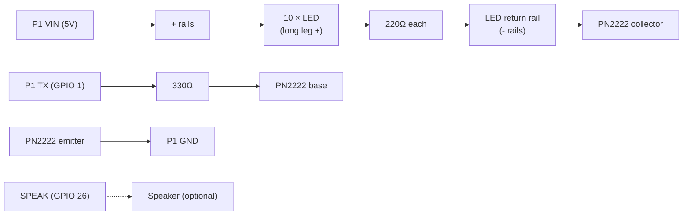

# Victoria Secret Display

A short video clip with music that plays on an ESP32 "Cheap Yellow Display" (CYD). A heart made of 10 LEDs on a breadboard, plus the display's built-in RGB light, pulses pink and purple in time with the song. Between plays, the heart does a slow "lub-dub" heartbeat.

Everything runs on the display board. The video, audio, and beat data are stored in `kylie_jenner_data.h`, so you don't need an SD card or Wi-Fi.

## Parts

- ESP32-2432S028R (CYD) with a 2.8" ILI9341 touchscreen
- 10 LEDs (pink, red, or white)
- 10 × 220 Ω resistors (one per LED)
- 1 × 330 Ω resistor
- 1 × PN2222 NPN transistor
- Breadboard and jumper wires
- The 4-pin cable that came with the CYD (for the P1 connector)
- Optional: a small speaker on the `SPEAK` connector

## Wiring

All the LED wiring goes through the P1 connector (`VIN | TX | RX | GND`). `RX` is not used.

| From | To |
| --- | --- |
| P1 `TX` | 330 Ω resistor, then the PN2222 base (middle leg) |
| P1 `GND` | PN2222 emitter (left leg, flat side facing you) |
| PN2222 collector (right leg) | LED return rail (both `-` rails) |
| P1 `VIN` | Both `+` rails (5 V for the LEDs) |
| Each LED long leg | `+` rail |
| Each LED short leg | 220 Ω resistor, then the LED return rail |
| `SPEAK` | Speaker (optional) |

### Diagram

```
                 CYD  P1 connector
            ┌─────┬──────┬──────┬─────┐
            │ VIN │  TX  │  RX  │ GND │
            └──┬──┴──┬───┴──────┴──┬──┘
               │     │   (unused)  │
               │   [330Ω]          │
               │     │             │
               │     │    PN2222   │
               │     │   ┌───────┐ │
               │     └──►│ B     │ │
               │         │     E ├─┘
               │     ┌───┤ C     │
               │     │   └───────┘
               │     │
   + rail ─────┴─────┼──────────────────────────
     │     │     │   │        │
    LED   LED   LED  │  ...  LED     (10 LEDs, long leg to + rail)
     │     │     │   │        │
   [220Ω][220Ω][220Ω]│      [220Ω]
     │     │     │   │        │
   LED return rail ──┴────────┴─────────────────
```



The `TX` pin drives the transistor, and the transistor switches the LED return to ground. The LEDs run from 5 V, so the ESP32 pin never carries the LED current.

## Pins used

| Function | GPIO |
| --- | --- |
| LED heart (P1 TX) | 1 |
| Speaker (DAC) | 26 |
| Touch IRQ | 36 |
| Onboard RGB (R / G / B) | 4 / 16 / 17 |
| Display DC / CS / SCK / MOSI / MISO / Backlight | 2 / 15 / 14 / 13 / 12 / 21 |

## Uploading

1. Install the [Arduino IDE](https://www.arduino.cc/en/software) or use the Arduino Cloud Editor.
2. Add the ESP32 boards package (Espressif Systems) through the Boards Manager.
3. Install these libraries:
   - **GFX Library for Arduino** by moononournation
   - **JPEGDEC** by Larry Bank
4. Put `VS.ino` and `kylie_jenner_data.h` in a folder named `VS`.
5. Select **ESP32 Dev Module** as the board.
6. Under **Tools > Partition Scheme**, choose **Huge APP (3MB No OTA)**. The clip data is too large for the default partition.
7. Connect the CYD over USB, pick its port, and click Upload.

Unplug the P1 cable while uploading if it fails to connect. The TX pin is shared with the USB serial line.

## Using it

- When the board powers on, the heart blinks twice and then the clip starts.
- Tap the screen to restart the clip.
- When the clip ends, the heart beats twice and the clip plays again.
- The heart may flicker briefly when the board starts or during an upload. This is normal.

## Settings

These values are at the top of `VS.ino`:

| Setting | Default | Meaning |
| --- | --- | --- |
| `VOLUME` | `80` | Speaker volume, 0–100 |
| `ROTATION` | `1` | `1` is landscape, `3` is landscape flipped |
| `LOOP_FOREVER` | `true` | `false` waits for a tap before replaying |

## Troubleshooting

- **The colors look inverted.** Change the last argument of `Arduino_ILI9341(...)` from `false` to `true`.
- **The screen stays white or blank.** Some CYD boards use an ST7789 panel. Replace the `gfx` line with:
  ```cpp
  Arduino_GFX *gfx = new Arduino_ST7789(bus, GFX_NOT_DEFINED, ROTATION, true, 240, 320);
  ```
- **The LEDs never light.** Check the transistor orientation, and confirm the LED long legs go to the `+` rail.
- **There's no sound.** The speaker is optional. The lights still follow the song without one.
